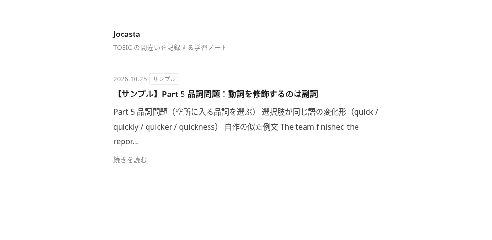

# Jocasta

いろいろなテーマの記事を書くブログです。Markdown で記事を書き、Astro（静的サイトを作るツール）でページにして、Cloudflare Workers で公開しています。

公開URL: https://blog.sol-momma.com



## 記事の書き方

### 1. /admin 編集画面

ブラウザで https://blog.sol-momma.com/admin/ を開くと、記事を書けます。保存すると GitHub の `main` に直接コミットされます。

**ログインする（トークン）**

1. GitHub で「Fine-grained personal access token」を作ります。対象のリポジトリは `Sol-momma/jocasta` だけにし、「Contents」を「Read and write」にします。
2. `/admin` で「トークンでログイン」を押し、作ったトークンを貼ります。
3. トークンの値は README・記事・チャットに書きません。なくしたら GitHub で作り直します。

**下書きと公開を切り替える**

- 「下書き」は入力欄の一番上にあります。新しい記事は、はじめからオン（下書き）です。
- オンのまま保存すると `draft: true` になります。一覧・記事ページ・テーマ一覧のどこにも出ません。
- 書きかけの見た目は、編集画面の右側のプレビューで確かめます。サイトに近い文字と箇条書きで表示されます。
- 公開するときは「下書き」をオフにして保存します（`draft: false`）。

**保存したあと**

保存しただけでは本番は変わりません。手元で `main` を取り込み、`pnpm run deploy` を実行すると本番に出ます。

```sh
git pull
pnpm run deploy   # build → 下書きが出ていないかの確認 → 公開
```

### 2. Markdown で書く

1. `templates/post.md` を `src/content/posts/` にコピーします。ファイル名がそのまま URL になります（例: `my-post.md` は `/posts/my-post/`）。ファイル名は英小文字とハイフンだけにします。
2. 先頭の frontmatter（`---` で囲んだ設定欄）を書き換えます。

   ```yaml
   ---
   title: "記事のタイトル"
   date: 2026-10-25
   theme: "toeic"     # テーマ名。一覧は src/lib/themes.ts
   tags: ["品詞"]
   draft: true        # 下書き。公開しない
   ---
   ```

   TOEIC の記事では `part`（例: `"Part 5"`）と `questionType` も書けます。項目の定義は `src/content.config.ts` にあります。
3. 本文を書きます。
4. 公開するときは `draft: true` を `draft: false` に変えます。`pnpm run dev` で見た目を確かめてから PR を出します。

> [!NOTE]
> `draft: true` の記事は `pnpm run dev` でも表示されません。見た目を確かめるときは `draft: false` にします。

書き方の例は `src/content/posts/sample-part5-word-form.md` です。公開中のサイトでは https://blog.sol-momma.com/guide/ にも手順があります。

> [!IMPORTANT]
> TOEIC などの問題文は載せません（著作権のため）。説明には自作の似た例文を使います。

> [!TIP]
> 本文は入れ子の箇条書き（半角スペース2つで字下げ）で書くと、子のある項目をページ上で折りたためます。

## 公開のしかた

保存（mainへのpush）で Cloudflare Workers Builds が自動で本番（https://blog.sol-momma.com）に出す。`draft: true` の下書きは `check:drafts` で止まる。

## コマンド

パッケージ管理には pnpm を使います。

```sh
pnpm install      # 依存パッケージを入れる
pnpm run dev      # 手元で確認（http://localhost:4321）
pnpm run build    # dist/ にサイトを作り、続けて Pagefind の検索用データ（dist/pagefind）を作る
pnpm run preview  # 作ったサイトを手元で確認
pnpm run check:drafts  # build のあと、下書きが dist/ に出ていないか確かめる
pnpm run deploy   # build・下書きの確認をしてから Cloudflare に公開（wrangler deploy）
```

> [!WARNING]
> `npm` `yarn` `bun` でインストールしないでください。`pnpm-lock.yaml` とずれます。

> [!CAUTION]
> `pnpm run deploy` は本番を書き換えます。PR をマージしてから実行してください。

## フォルダの構成

```text
.
├── .github/workflows/ci.yml   # PR ごとに build と deploy の試運転
├── docs/                      # README の画像・参考にしたブログの一覧
├── src/
│   ├── components/            # 記事一覧・目次・読み進みバー
│   ├── content/posts/         # 記事（Markdown）
│   ├── content.config.ts      # frontmatter の定義
│   ├── layouts/Base.astro     # 全ページ共通の枠
│   ├── lib/                   # テーマ名・記事の並べ方・GitHub へのリンク
│   └── pages/                 # URL ごとのページ（/、/posts/、/themes/、/guide/）
├── scripts/check-drafts.mjs   # 下書きが dist/ に出ていないか確かめる
├── templates/post.md          # 記事のひな形
├── astro.config.mjs
├── wrangler.jsonc             # Cloudflare Workers の設定（カスタムドメインもここ）
├── package.json
└── AGENTS.md                  # AI に作業を頼むときの決まり
```

## 使っている技術

- [Astro](https://astro.build/): Markdown から静的なページを作る
- [Cloudflare Workers](https://developers.cloudflare.com/workers/static-assets/): 作ったページを配る（無料プラン）
- [wrangler](https://developers.cloudflare.com/workers/wrangler/): Cloudflare に公開するコマンド
- [pnpm](https://pnpm.io/): パッケージ管理
- GitHub Actions: PR ごとの build 確認

## 参考にしたブログ

見た目や読みやすさで参考にしたブログは [docs/references.md](docs/references.md) にまとめています。記事ページの形は [Naoya Tech](https://naoya-tech.com)、フッターは [maguro.dev](https://maguro.dev) を参考にしました。

## 背景の絵

- 背景（木・山・波・星空・雨・雲・街・鳥・魚・蝶・猫・落ち葉・花）は `src/components/bg/` にあるこのブログのオリジナルです（以前は antfu.me の ArtPlum.vue を書き直した木を使っていましたが、作り直して元のコードは使っていません）。
- 「表示」の設定で「ランダム（最初の設定）」「どれか1つに固定」「なし」を選べます。ランダムはページを開くたびに変わります。
- 新しい背景を足すときは、`src/components/bg/` にファイルを作って `window.BG` に登録し、`src/lib/backgrounds.ts` と `src/components/Background.astro` に足します。
