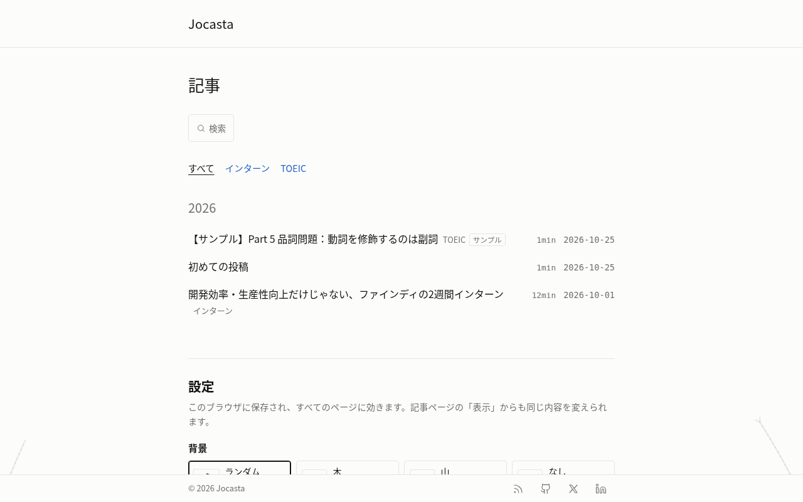
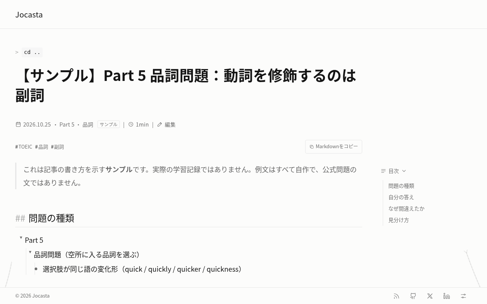

# Jocasta

いろいろなテーマの学習記録を書く、日本語の個人ブログです。Markdown で書いた記事を Astro で静的なページにし、Cloudflare Workers で公開しています。

> **English summary:** Jocasta is a Japanese-language study blog by Sol-momma. Posts are written in Markdown, built into a static site with Astro, and served from Cloudflare Workers. Run it locally with `pnpm install` and `pnpm run dev`.

公開URL: https://blog.sol-momma.com





## できること

- テーマ別の記事一覧と、年ごとにまとめた記事一覧
- 入れ子の箇条書きを折りたためる記事ページと、目次・読み進みバー
- Pagefind によるサイト内検索
- 関連する記事の表示、RSS、記事ごとの OGP 画像
- 背景の絵（木・山・波・星空・雨・雲・街）と読み進みバーの切り替え（フッターの「表示」から）
- ブラウザの編集画面（`/admin`、Sveltia CMS）からの記事の作成
- `draft: true` の下書きは一覧にも記事ページにも出さない

## 使っている技術

- [Astro](https://astro.build/)：Markdown から静的なページを作る
- [Pagefind](https://pagefind.app/)：サイト内検索
- [Sveltia CMS](https://github.com/sveltia/sveltia-cms)：ブラウザの編集画面
- [satori](https://github.com/vercel/satori) と [resvg-js](https://github.com/yisibl/resvg-js)：OGP 画像
- [Cloudflare Workers](https://developers.cloudflare.com/workers/static-assets/) と [wrangler](https://developers.cloudflare.com/workers/wrangler/)：公開
- [pnpm](https://pnpm.io/)：パッケージ管理
- GitHub Actions：PR ごとの build の確認

## 動かし方

Node.js と pnpm（`package.json` の `packageManager` で版を固定）を使います。npm・yarn・bun でインストールすると `pnpm-lock.yaml` とずれるので使いません。

```sh
git clone https://github.com/Sol-momma/jocasta.git
cd jocasta
pnpm install
pnpm run dev      # http://localhost:4321 で確認
pnpm run build    # dist/ にサイトと検索用データを作る
pnpm test         # 単体テスト
```

`draft: true` の記事は `pnpm run dev` でも表示されません。見た目を確かめるときは `draft: false` にします。

## 記事の書き方

1. `templates/post.md` を `src/content/posts/<英小文字-ハイフン>.md` にコピーします。ファイル名が URL（`/posts/<名前>/`）になります。
2. 先頭の frontmatter を書き換えます。

   ```yaml
   ---
   title: "記事のタイトル"
   date: 2026-10-25
   theme: "toeic"     # テーマ名。一覧は src/lib/themes.ts
   tags: ["品詞"]
   draft: true        # 下書き。公開するときは false
   ---
   ```

3. 本文は入れ子の箇条書き（半角スペース2つで字下げ）で書くと、ページ上で折りたためます。

書き方の例は `src/content/posts/sample-part5-word-form.md` と https://blog.sol-momma.com/guide/ にあります。TOEIC などの問題文は著作権のため載せず、自作の似た例文に置き換えます。

## フォルダの作り

```text
.
├── docs/                 # README の画像、参考にしたブログの一覧
├── public/admin/         # 編集画面（Sveltia CMS）の設定
├── scripts/              # 下書き・OGP・SEO の確認、リンクカードの取得
├── src/
│   ├── components/       # 記事一覧・目次・検索・背景など
│   ├── content/posts/    # 記事（Markdown）
│   ├── layouts/          # 全ページ共通の枠
│   ├── lib/              # テーマ名・記事の並べ方など
│   └── pages/            # URL ごとのページ
├── templates/post.md     # 記事のひな形
├── tests/                # 単体テスト
└── wrangler.jsonc        # Cloudflare Workers の設定
```

## 参考にしたブログ

見た目や読みやすさで参考にしたブログの一覧は [docs/references.md](docs/references.md) にあります。記事ページの形は [Naoya Tech](https://naoya-tech.com)、フッターと年ごとの記事一覧は [maguro.dev](https://maguro.dev)、文字・色・余白は [Boris Cherny's Blog](https://borischerny.com) を参考にしました。

背景の絵（`src/components/bg/`）はこのブログのために作ったものです。以前は [antfu.me](https://antfu.me) の ArtPlum を書き直した木を使っていましたが、今は作り直していて元のコードは使っていません。

## ライセンス

リポジトリ全体のライセンスは定めていません。同梱のフォント Noto Sans JP は SIL Open Font License 1.1 です（[licenses/NotoSansJP-OFL.txt](licenses/NotoSansJP-OFL.txt)）。
